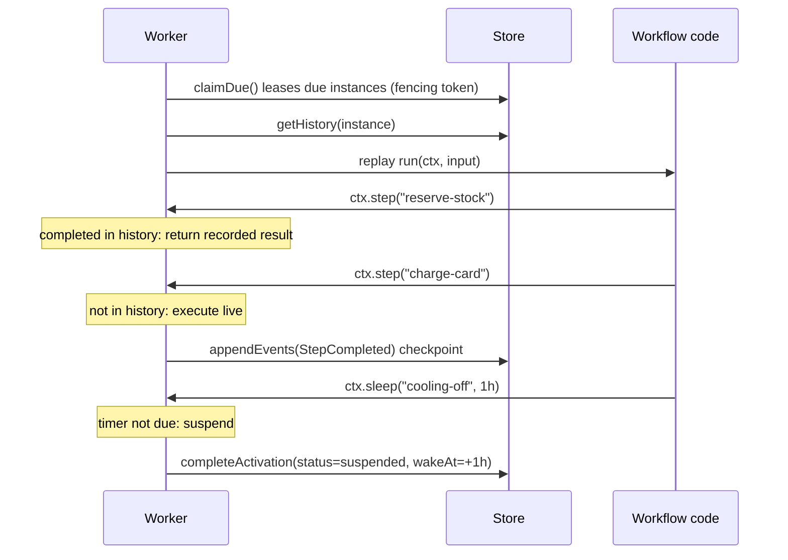

# durably

[](https://github.com/mengxie/durably/actions/workflows/ci.yml)
[](https://github.com/mengxie/durably/actions/workflows/codeql.yml)


[](LICENSE)

**Durable, event-sourced workflows for TypeScript.** Write long-running business processes as
plain `async` functions. durably records every step in an append-only event history, so a
workflow survives crashes, deploys and restarts, and resumes exactly where it stopped: minutes,
days or weeks later.

It is a compact, dependency-free take on the durable-execution model popularised by Temporal and
Azure Durable Functions, built to be read, understood and extended.

```ts
const fulfilOrder = defineWorkflow({
  name: 'fulfil-order',
  run: async (ctx, order: Order) => {
    await ctx.step('reserve-stock', () => inventory.reserve(order), {
      compensate: (reservation) => inventory.release(reservation), // saga undo
    });

    const charge = await ctx.step(
      'charge-card',
      ({ idempotencyKey }) => payments.charge(order.total, idempotencyKey),
      {
        retry: { maxAttempts: 5, initialInterval: '1s' }, // durable backoff
        compensate: (charge) => payments.refund(charge),
      },
    );

    if (order.total > 1000) {
      await ctx.waitForSignal('manager-approval', { timeout: '2d' }); // human in the loop
    }

    await ctx.sleep('cooling-off-period', '1h'); // durable timer
    return ctx.step('ship', () => shipping.create(order));
  },
});
```

If the process dies after `charge-card`, the card is **not** charged again: on restart the
workflow is replayed against its history, completed steps return their recorded results, and
execution continues with the next step.

## Features

- **Deterministic replay.** Workflow state is rebuilt from history; no hand-written state machines.
- **Durable retries** with exponential backoff and jitter. A retry scheduled for tomorrow survives a restart today.
- **Durable timers** (`ctx.sleep`) from milliseconds to months, with no process left waiting.
- **Signals** for external events and human approvals, buffered if they arrive early, with timeouts.
- **Saga compensation.** Undo actions run durably, in reverse order, when a workflow fails.
- **Parallelism** with plain `Promise.all` / `Promise.race` over durable operations.
- **Non-determinism detection.** Incompatible code changes fail loudly instead of corrupting state.
- **Side-by-side versions** so in-flight instances finish on the code they started with.
- **Horizontal scaling.** Any number of workers share one store, coordinated by leases with fencing tokens.
- **Pluggable storage** (ports and adapters): in-memory and SQLite included, both verified by one shared contract suite.
- **Zero runtime dependencies**, strict TypeScript, fully typed inputs, outputs and signals.

## Quick start

```bash
git clone https://github.com/mengxie/durably.git && cd durably
npm ci
npm run example:order   # runs a full order-fulfilment saga against SQLite
```

```ts
import { defineWorkflow, Engine } from '@mengxie/durably';
import { SqliteWorkflowStore } from '@mengxie/durably/sqlite';

const engine = new Engine({
  store: new SqliteWorkflowStore({ path: 'workflows.db' }),
  workflows: [fulfilOrder],
});

engine.createWorker({ concurrency: 20 }).start();

// Starting is idempotent per id: a retried HTTP request will not create a second order.
const handle = await engine.start(fulfilOrder, order, { id: order.id });
await engine.signal(order.id, 'manager-approval', { approvedBy: 'Aroha' });
const result = await handle.result(); // fully typed from the workflow definition
```

## How it works

Each time a workflow needs to make progress, a worker runs an **activation**: it replays the
workflow function from the beginning against the recorded history. Every durable operation gets a
sequence number. If history already holds that operation's outcome, the outcome is returned
immediately and no side effect happens; otherwise the operation runs for real and its outcome is
appended to history. When the workflow reaches something that cannot finish yet (a timer, a retry
delay or a missing signal), the activation records when it should wake up and ends.



See [docs/architecture.md](docs/architecture.md) for the full design: the instance state machine,
lease and fencing semantics, lost wake-up prevention, quiescence detection and compensation keying.

## Guarantees

| Concern            | Guarantee                                                                                                                                                                                                              |
| ------------------ | ---------------------------------------------------------------------------------------------------------------------------------------------------------------------------------------------------------------------- |
| Workflow code      | Replayed many times; must be deterministic. Divergence is detected and fails the instance.                                                                                                                             |
| Steps              | **At least once.** Each result is checkpointed immediately, so a crash re-runs at most the step that was in flight. Pass `idempotencyKey` (stable across retries and replays) to downstream APIs for effectively-once. |
| Timers, signals    | Exactly once in history; signals of the same name are consumed in arrival order.                                                                                                                                       |
| Concurrent workers | An instance is driven by one worker at a time. A stalled worker whose lease expired is fenced out on its next write.                                                                                                   |
| Compensations      | Run durably with their own retry policy, latest first; failures are reported on the failed instance.                                                                                                                   |

## Testing workflows

Inject a `ManualClock` and drive the engine with `runUntilIdle()`. A week-long workflow tests in
milliseconds, with no fake timers and no flakiness:

```ts
const clock = new ManualClock();
const engine = new Engine({ store: new InMemoryWorkflowStore(), clock, workflows: [reminder] });

const handle = await engine.start(reminder, { userId: 'u1' });
await engine.runUntilIdle(); // runs until the workflow sleeps
clock.advance('7d');
await engine.runUntilIdle(); // timer fires, workflow completes
expect(await handle.result()).toBe('reminder-sent');
```

## Project structure

```
src/
  core/        Domain: workflow contract, history events, errors, retry policy, clock. No I/O.
  runtime/     Application: Engine, Activation (one replay run), ReplayContext, Worker.
  storage/     Port (WorkflowStore) + adapters (in-memory, SQLite) + shared state rules.
test/          150 tests; engine suites run against every store; a contract suite every adapter must pass.
examples/      Runnable order-fulfilment saga.
docs/          Architecture guide and Architecture Decision Records.
```

Dependencies point inwards only: `storage` and `runtime` depend on `core`, never the reverse.
A new store (Postgres, DynamoDB, ...) is complete when it passes
[`test/store-contract.ts`](test/store-contract.ts) unchanged.

## Design decisions

Key decisions are recorded as ADRs in [docs/adr](docs/adr):

1. [Event-sourced history as the single source of truth](docs/adr/0001-event-sourced-history.md)
2. [Replay-based execution, suspending with never-settling promises](docs/adr/0002-replay-with-never-settling-promises.md)
3. [At-least-once steps with per-step checkpoints and idempotency keys](docs/adr/0003-at-least-once-steps.md)
4. [Leases with fencing tokens for multi-worker safety](docs/adr/0004-leases-with-fencing-tokens.md)
5. [Zero runtime dependencies; `node:sqlite` for durable storage](docs/adr/0005-zero-dependencies-node-sqlite.md)

## Development

```bash
npm run verify        # format check, lint, typecheck, tests with coverage, build (what CI runs)
npm test              # tests only
npm run test:watch
```

Quality gates: TypeScript in its strictest configuration (`exactOptionalPropertyTypes`,
`noUncheckedIndexedAccess`, ...), typescript-eslint `strict-type-checked`, Prettier, and coverage
thresholds of 90% lines, functions and statements. CI runs on Node 22 and 24, with CodeQL
analysis and Dependabot updates.

> `node:sqlite` is still flagged experimental by Node, which prints a one-line warning when the
> SQLite adapter is loaded. The in-memory store and the engine do not use it.

## Roadmap

- Postgres adapter using `SELECT ... FOR UPDATE SKIP LOCKED` for claims
- Child workflows and `continueAsNew` for unbounded histories
- Cancellation with scoped compensation
- OpenTelemetry tracing via the `EngineObserver` hooks
- Semaphore-based worker scheduling instead of batch polling

## License

[MIT](LICENSE) © Meng Xie
