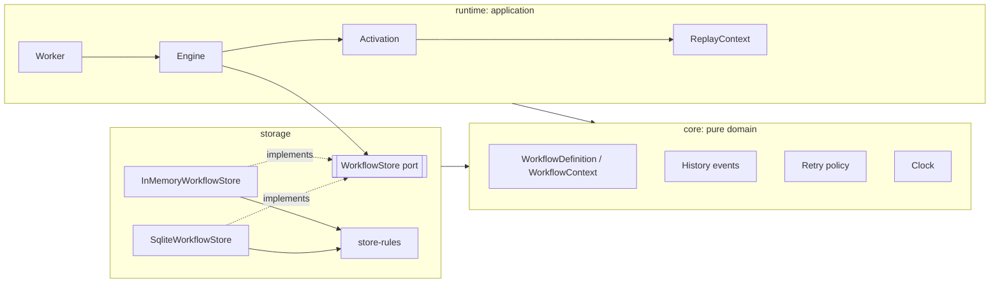
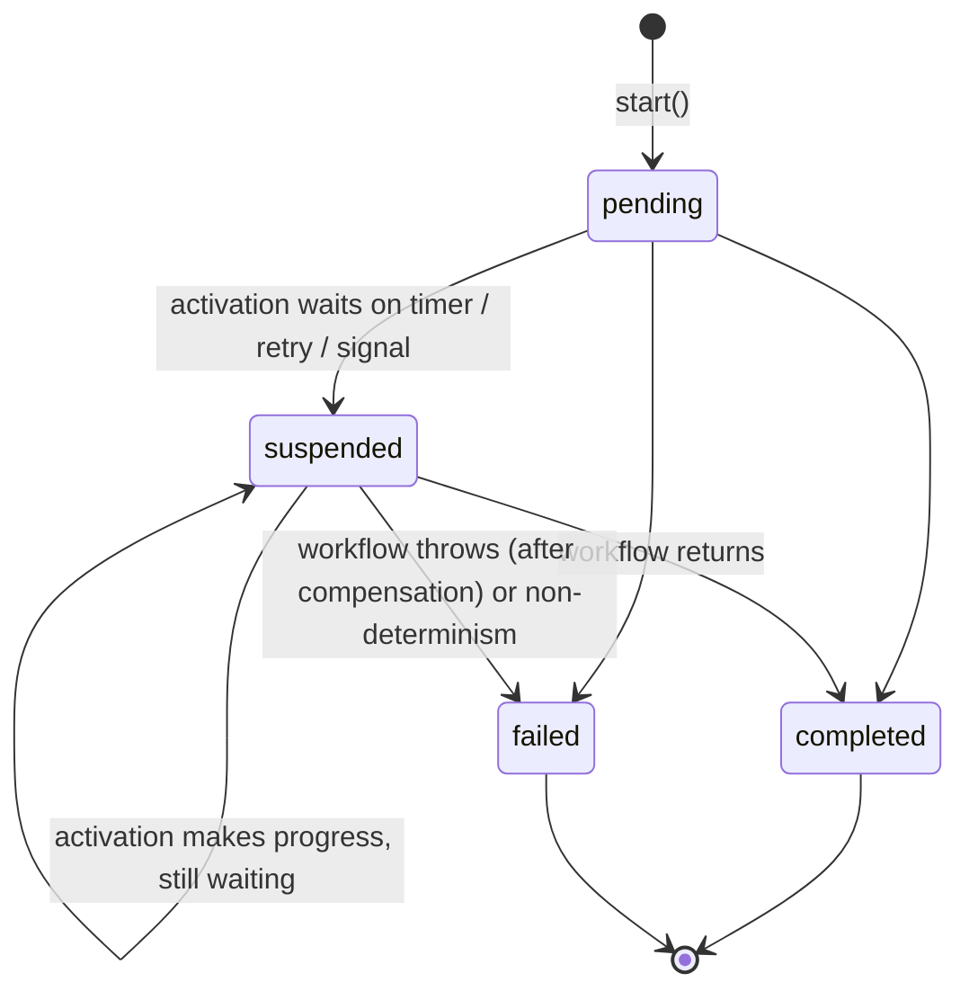

# Architecture

This document explains how durably works internally and why it is built this way. Decisions with
real alternatives are captured separately as [ADRs](adr).

## Layers

durably follows a ports-and-adapters (hexagonal) layout. Dependencies only point inwards.

| Component       | Responsibility                                                                                      |
| --------------- | --------------------------------------------------------------------------------------------------- |
| `Engine`        | Public API: start, signal, query. Claims due instances, runs activations and commits their outcome. |
| `Activation`    | One replay run of one instance. Decides the outcome: completed, failed, suspended or aborted.       |
| `ReplayContext` | Implements `WorkflowContext`: matches each durable operation to history or executes it live.        |
| `Worker`        | Poll loop with graceful shutdown. Knows nothing about workflows, only `tick()`.                     |
| `WorkflowStore` | Persistence port. Every method is atomic; correctness rests on that plus fencing tokens.            |
| `store-rules`   | Pure state-transition rules shared by every adapter, so adapters only handle persistence.           |

## History and instances

The **history** (an append-only list of events per instance) is the source of truth. The
**instance** row is a materialised view used for scheduling: `status`, `wakeAt`, the lease, and
the final output or error.

An instance is **due** when it is not terminal, `wakeAt <= now`, and it is not leased (or the
lease expired). `wakeAt = null` means only a signal can wake it.

## An activation, step by step

1. `claimDue` atomically leases due instances, each with a fresh **fencing token**.
2. The engine loads the full history and starts an `Activation`.
3. The workflow function is invoked from the top. Each call to `step`, `sleep` or
   `waitForSignal` takes the next operation index (`op`) and looks it up in history:
   - **Terminal outcome recorded:** return it (or rethrow the recorded failure). No side effects.
   - **Step not yet completed:** if a retry is pending and not yet due, suspend; otherwise run it.
     The result is appended to history immediately (a checkpoint, which also renews the lease).
   - **Timer or signal not yet satisfied:** record when to wake up and suspend that branch.
4. The activation waits for **quiescence**: no step in flight and the microtask queue drained.
5. The outcome is committed with `completeActivation`, which also releases the lease.

### Suspension without exceptions

Operations that cannot finish return a promise that never settles, and record an interruption.
The activation races the workflow body against the first interruption. This is deliberate:
throwing a sentinel error would be swallowed by any `try/catch` in workflow code (see
[ADR 0002](adr/0002-replay-with-never-settling-promises.md)). Each never-settling promise is a
fresh object, so an abandoned replay is garbage-collected rather than leaking reactions.

Suspension does not stop _other_ branches. In `Promise.race([ctx.sleep('sla', '1h'), ctx.step('work', ...)])`
the step still runs, and if it wins the race the workflow completes in the same activation. The
outcome is chosen by priority: abort > non-determinism > the body settled > suspended.

### Quiescence

Workflow code may only await durable operations, so once no step is executing and a macrotask
turn has passed (letting every microtask continuation run), the workflow cannot make further
progress on its own. `ReplayContext.quiesce()` loops until that holds. This is what lets
`Promise.all` branches, fire-and-forget steps and racing timers all settle deterministically
before the outcome is committed.

## Determinism checks

Each operation's `kind` and `name` must match what history recorded for its index. Inserting,
removing or reordering operations in deployed code therefore fails the instance with a
`NonDeterminismError` (`code: NON_DETERMINISM`) instead of silently feeding the wrong results to
the wrong steps. On completion, the engine also verifies that history holds no operation beyond
those the code issued, catching removed trailing steps.

The supported way to change workflow code incompatibly is a **new version**: register both
`version: 1` and `version: 2`; new instances use v2 and in-flight v1 instances finish on v1. An
engine that does not know an instance's version defers it (see "rolling deploys" below).

## Retries

A failed attempt appends `StepAttemptFailed` with an absolute `retryAt` computed from the policy
(exponential backoff, capped, with optional "equal jitter" within 50 to 100% of the delay). The
jittered value is computed once and recorded, so replay stays deterministic. The instance then
sleeps until `retryAt`; there are no in-process retry loops holding a lease.

Errors that are `NonRetryableError` (or whose `name` is listed in `nonRetryableErrors`) fail the
step immediately. A failed step surfaces in workflow code as a catchable `StepFailedError`.

## Signals and lost wake-ups

`engine.signal()` appends `SignalReceived` to history, increments `signalCount` and makes the
instance due. Signals are consumed strictly in arrival order, by the first operation waiting for
that name, which keeps consumption deterministic.

A signal can arrive _while_ an activation is running, after it read the history. Without care,
the activation would then commit "suspended, waiting for a signal" and sleep forever. The store
prevents this: the activation reports the `signalCount` it saw at claim time, and if the count
moved on, `completeActivation` sets `wakeAt = now` regardless of what the activation asked for.
The rule lives in `store-rules.ts`, shared by every adapter, and is covered by the contract suite.

## Saga compensation

`step(name, fn, { compensate })` registers an undo action once the step has completed. If the
workflow body throws, the activation waits for in-flight steps, then runs the registered
compensations as durable steps, latest first, each with its own retry policy. Compensation
failures do not stop the others; they are reported in the `WorkflowFailed` event.

Compensation steps are keyed by the operation they undo (`c<op>`) rather than by their position
in the compensation sequence. Parallel steps may complete in different orders in a live run and a
replay; position-based keys would then mismatch, while operation-based keys cannot.

## Leases, heartbeats and fencing

Claiming gives a worker a lease with an expiry and a unique token. Every write (checkpoint,
heartbeat, commit) must present the current token. If a worker stalls (a long GC pause, a
network partition) and its lease expires, another worker claims the instance with a new token;
the stalled worker's next write fails with `LeaseLostError` and it abandons the activation. This
is the classic fencing-token pattern and is what makes multiple workers safe
([ADR 0004](adr/0004-leases-with-fencing-tokens.md)).

During long steps the engine heartbeats every third of the lease duration. A failed heartbeat
aborts the activation early.

## Rolling deploys

If an engine claims an instance whose workflow name and version it does not have registered, it
does not fail it. It releases it with `wakeAt = now + unregisteredWorkflowDelay` (default 1
minute) and reports the problem to the observer, so an engine that still has that version can
pick it up.

## Observability

`EngineObserver` exposes hooks for workflow starts, activation outcomes and durations, replay-aware
workflow logs and errors by phase (`claim`, `activation`, `commit`, `heartbeat`). Observer
exceptions are swallowed so that a broken metrics backend cannot stop workflows. The hooks are
the intended place to attach structured logging, metrics or OpenTelemetry spans.

## Known limitations

- Histories grow without bound for very long-lived instances; `continueAsNew` is on the roadmap.
- The worker processes claims in batches; one slow activation delays the next poll.
- The SQLite adapter suits a single host. Multiple hosts need a networked store such as Postgres.
